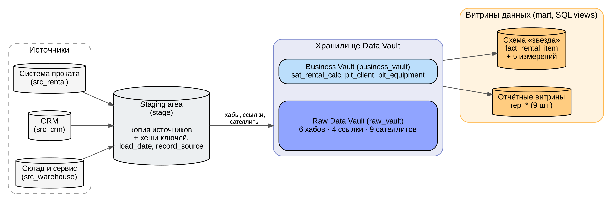
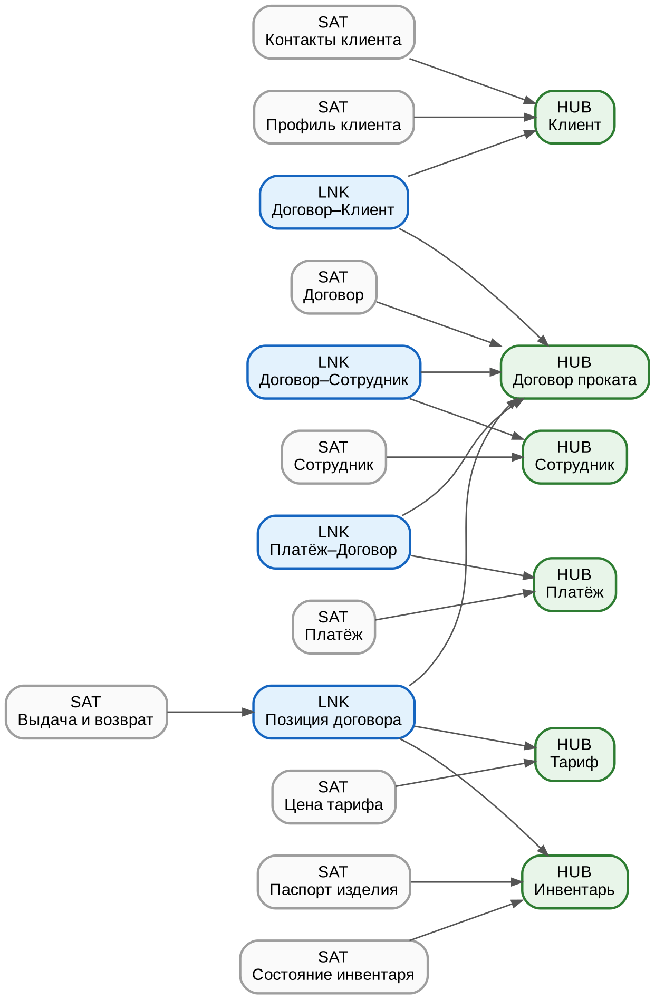
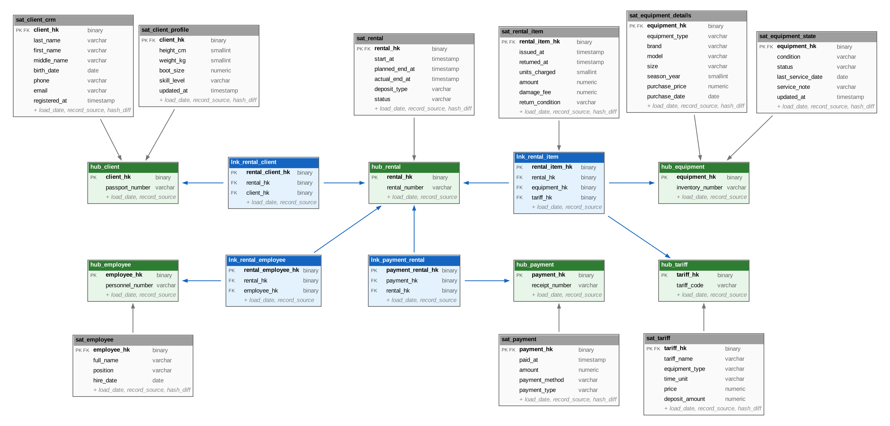
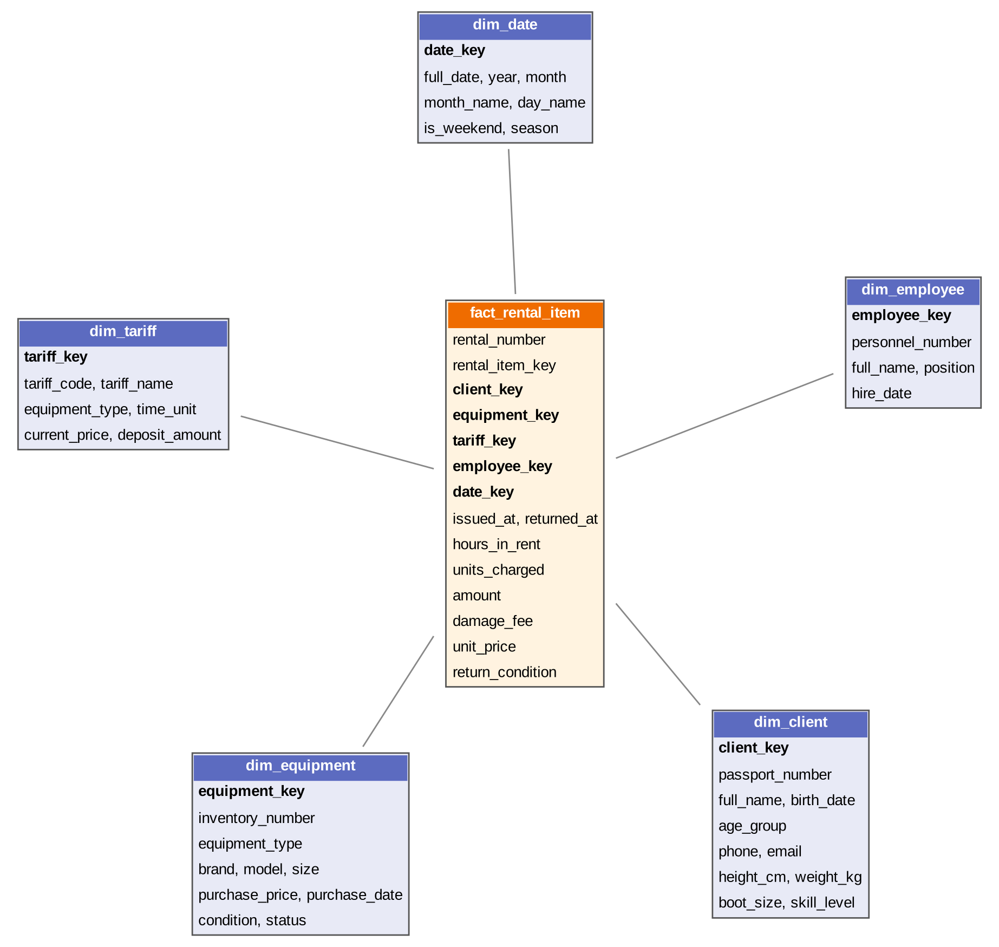

# Хранилище данных Data Vault: система учёта проката на лыжной базе

Лабораторная работа № 1 по дисциплине «Хранилища данных», вариант 15.
Выполнил: Музалёв А.С., группа 223-321, Московский Политех, факультет «Информационные технологии», кафедра «Прикладная информатика».

Хранилище спроектировано по методологии **Data Vault 2.0** и реализовано в **PostgreSQL**. Данные трёх операционных систем лыжной базы (система проката, CRM, склад и сервисная мастерская) проходят через staging area, загружаются в Raw Data Vault, обрабатываются в Business Vault и выводятся в витрины данных.



## Состав репозитория

| Папка / файл | Содержимое |
|---|---|
| `docs/` | Отчёт по лабораторной работе (Word) |
| `sql/` | SQL-скрипты создания и загрузки хранилища |
| `images/` | Схемы модели и архитектуры |

### SQL-скрипты

| Файл | Назначение |
|---|---|
| `00_init.sql` | Создание схем источников и слоёв хранилища |
| `01_sources_ddl.sql` | Таблицы операционных систем-источников |
| `02_stage_ddl.sql` | Хеш-функции и таблицы staging area |
| `03_raw_vault_ddl.sql` | Хабы, ссылки и сателлиты Raw Data Vault |
| `04_business_vault_ddl.sql` | Расчётный сателлит и PIT-таблицы Business Vault |
| `05_etl.sql` | Журнал загрузок и процедуры ETL |
| `06_marts.sql` | Измерения, факт и отчётные витрины |
| `07_batch1_sources_data.sql` | Данные источников для пакета 1 (на 10.01.2026) |
| `08_batch2_sources_changes.sql` | Изменения источников для пакета 2 (по 15.02.2026) |
| `09_batch3_sources_changes.sql` | Изменения источников для пакета 3 (по 31.03.2026) |
| `10_check_queries.sql` | Проверочные и демонстрационные запросы |
| `run_all.sql` | Полный сценарий: структура, три пакета загрузки, проверки |

## Запуск

Требуется PostgreSQL 14 или новее.

```bash
cd sql
createdb ski_rental_dwh
psql -d ski_rental_dwh -v ON_ERROR_STOP=1 -f run_all.sql
```

Сценарий создаёт все объекты, выполняет три пакета загрузки (11.01.2026, 16.02.2026, 01.04.2026) и выводит результаты проверочных запросов.

## Модель данных

**Raw Data Vault:** 6 хабов, 4 ссылки, 9 сателлитов.

| Хаб | Бизнес-ключ |
|---|---|
| `hub_client` | серия и номер паспорта |
| `hub_equipment` | инвентарный номер |
| `hub_tariff` | код тарифа |
| `hub_employee` | табельный номер |
| `hub_rental` | номер договора проката |
| `hub_payment` | номер кассового чека |

Ссылки: `lnk_rental_client`, `lnk_rental_employee`, `lnk_rental_item` (договор — инвентарь — тариф), `lnk_payment_rental`.



Физическая модель с полями таблиц:



**Business Vault:** расчётный сателлит договора `sat_rental_calc` (начисления, оплаты, остаток, просрочка) и PIT-таблицы `pit_client`, `pit_equipment`.

**Витрины (схема `mart`):** схема «звезда» (`fact_rental_item` и 5 измерений) и 9 отчётных представлений: выручка по месяцам, окупаемость инвентаря, активность клиентов, открытые договоры, показатели сотрудников, спрос по дням недели, история цен тарифов, состояние парка инвентаря, платежи.


